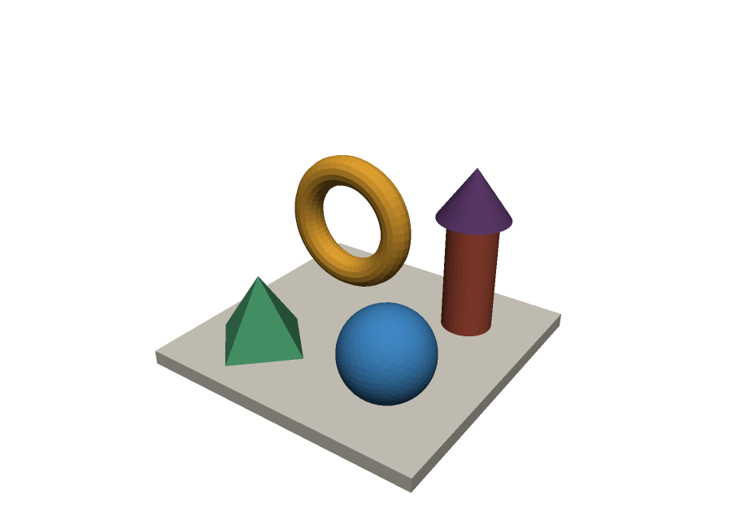

# model3d

Saf Python ile yazılmış, **hiçbir bağımlılığı olmayan** küçük bir 3D model kütüphanesi.



## Özellikler

- **Matematik:** `Vec3` (vektör) ve `Mat4` (4x4 dönüşüm matrisi: öteleme, ölçek, döndürme, `look_at`, perspektif/ortografik projeksiyon, ters matris, determinant)
- **Mesh:** indeksli üçgen ağı (`Mesh`)
  - sınırlayıcı kutu, yüzey alanı, hacim, yüz/köşe normalleri
  - su geçirmezlik (watertight) ve yönelim tutarlılığı kontrolü
  - öteleme, ölçekleme, döndürme, ortalama, birleştirme (`+`), köşe kaynaklama (weld), alt bölümleme (subdivide)
- **Primitifler:** `box`, `cube`, `plane`, `uv_sphere`, `icosphere`, `icosahedron`, `cylinder`, `cone`, `torus`, `pyramid`
  — tüm kapalı şekiller su geçirmezdir ve normalleri dışa bakar
- **Dosya formatları:** OBJ, STL (ASCII + binary), PLY (ASCII + binary little/big endian) okuma ve yazma
- **Render:** düz gölgeli SVG (vektörel) ve z-buffer'lı PNG (kenar yumuşatmalı) çıktısı
- **Komut satırı aracı:** `info`, `convert`, `render`, `create`

## Kurulum

```bash
pip install .
```

Ya da kurmadan, depo kökünden doğrudan `import model3d` ile kullanabilirsiniz (Python 3.8+).

## Hızlı başlangıç

```python
import model3d as m3

# Şekil oluştur ve dönüştür
taban = m3.box(4, 4, 0.2)
halka = m3.torus(0.8, 0.2).rotated(m3.UNIT_X, 90, degrees=True).translated(0, 0, 1)
sahne = taban + halka

print(sahne.stats())          # köşe/yüz sayısı, sınırlar, alan, hacim...
print(sahne.is_watertight())  # True

# Kaydet / yükle (format uzantıdan anlaşılır)
m3.save(sahne, "sahne.stl")               # binary STL
m3.save(sahne, "sahne.obj", normals=True)
yeniden = m3.load("sahne.stl")

# Render
m3.save_png(sahne, "sahne.png", width=800, height=600, supersample=2)
m3.save_svg(sahne, "sahne.svg", stroke="#222")  # tel kafes kenarlarla
```

Birden fazla renkli nesne ve özel kamera:

```python
modeller = [
    m3.Model(m3.cube(), color="#c0392b"),
    m3.Model(m3.icosphere(0.5, 3), color=(52, 152, 219),
             transform=m3.Mat4.translation(1.5, 0, 0)),
]
kamera = m3.Camera(eye=m3.Vec3(4, -6, 3), target=m3.Vec3(0.75, 0, 0))
m3.save_png(modeller, "renkli.png", camera=kamera)
```

## Komut satırı

```bash
python -m model3d create torus torus.stl --scale 2
python -m model3d info torus.stl
python -m model3d convert torus.stl torus.obj --center
python -m model3d render torus.obj torus.png --width 640 --height 480
python -m model3d render torus.obj torus.svg --wireframe --ortho
```

## Kurallar

- Koordinat sistemi sağ el kuralına göredir; **Z ekseni yukarıdır**.
- Üçgenler dışarıdan bakıldığında saat yönünün tersine sıralanır, yani `(b - a) × (c - a)` dışa bakar.
- `Mesh` dönüşüm metotları (`translated`, `scaled`, `rotated`, ...) her zaman **yeni** bir mesh döndürür.
- Aynalama (negatif determinantlı dönüşüm) uygulandığında sarım yönü otomatik düzeltilir.
- SVG render'ı ressam algoritması kullanır; çok büyük üçgenler küçüklerle yan yana olduğunda sıralama
  hatası olabilir. Kesin görünürlük için PNG render'ını (`save_png`) kullanın.

## Örnek ve testler

```bash
python examples/demo.py               # examples/output/ altına OBJ, STL, PLY, SVG, PNG yazar
python -m unittest discover -s tests  # testleri çalıştırır
```

## Proje yapısı

```
model3d/
  vector.py      Vec3
  matrix.py      Mat4
  mesh.py        Mesh, BoundingBox
  primitives.py  hazır şekiller
  io.py          OBJ / STL / PLY okuma-yazma
  render.py      Camera, Model, SVG ve PNG render
  __main__.py    komut satırı aracı
tests/           unittest testleri
examples/        örnek betik
```
